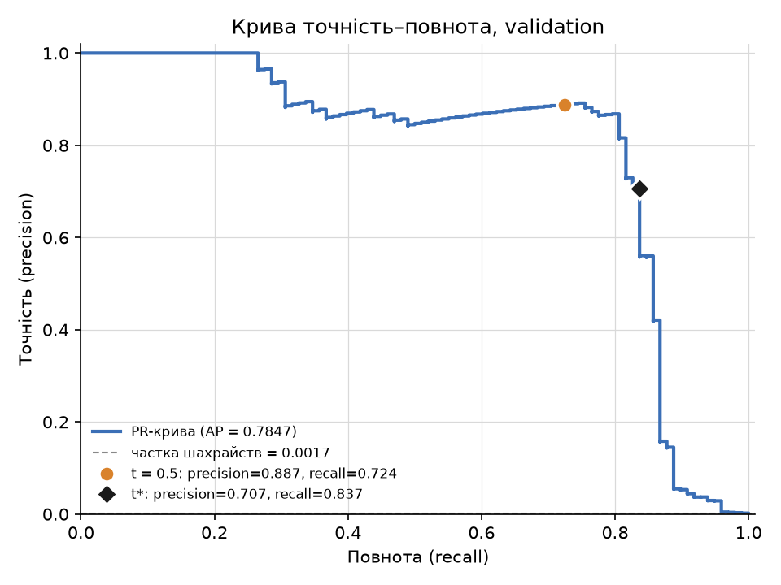
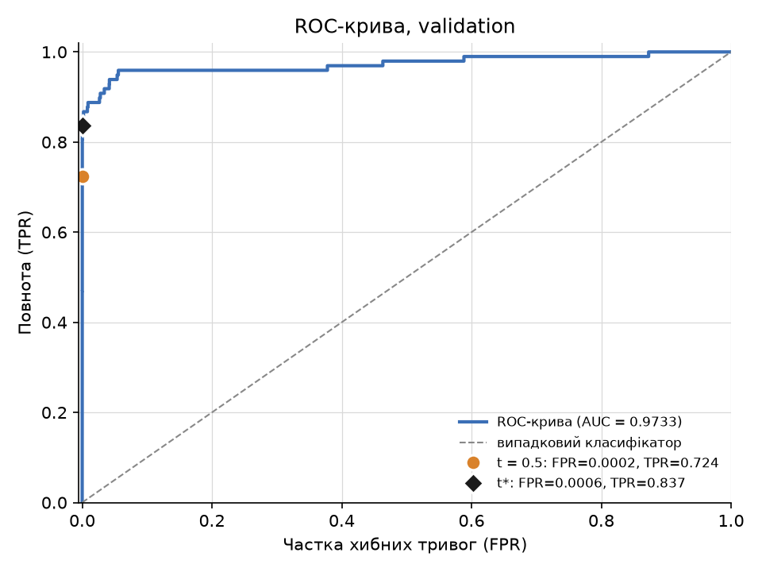

# ЛР2. Поріг рішення під асиметричну ціну помилок

Бінарна класифікація шахрайських транзакцій (Credit Card Fraud Detection). Модель **не змінюється** (MLP `29 → 32 → 1`, навчається один раз); змінюється лише **правило рішення** — поріг $t$, який обирається на validation за мінімумом вартості

$$
C(t) = 10\,FN(t) + FP(t).
$$

Числові результати запусків (таблиці в розділах 8 і 9) генеруються скриптами й вставляються між маркерами `CHECKS` та `RESULTS`; вручну там нічого не вписувалось (див. [Відтворюваність](#відтворюваність)).

---

## Зміст

1. [Як запустити](#1-як-запустити)
2. [Файли проєкту](#2-файли-проєкту)
3. [Дані та поділ](#3-дані-та-поділ)
4. [Модель і навчання](#4-модель-і-навчання)
5. [Метрики та вартість](#5-метрики-та-вартість)
6. [Пошук порога: алгоритм](#6-пошук-порога-алгоритм)
7. [Чому висока ROC-AUC не гарантує малу вартість і високу precision](#7-чому-висока-roc-auc-не-гарантує-малу-вартість-і-високу-precision)
8. [Перевірка пошуку порога (набори A, B, C)](#8-перевірка-пошуку-порога-набори-a-b-c)
9. [Результати](#9-результати)
10. [Висновки](#10-висновки)
11. [Відтворюваність](#відтворюваність)
12. [Джерела та використані інструменти](#джерела-та-використані-інструменти)

---

## 1. Як запустити

Потрібні [uv](https://docs.astral.sh/uv/) і Python 3.12 (uv підбере його сам за `.python-version`). Версії залежностей зафіксовано в `uv.lock` (дублюються в `requirements.txt`).

**Набір даних:** `creditcard.csv` — [Credit Card Fraud Detection (Kaggle, mlg-ulb)](https://www.kaggle.com/datasets/mlg-ulb/creditcardfraud); дзеркало з тим самим вмістом (284 807 рядків, 492 шахрайські) — [OpenML, id 1597](https://www.openml.org/d/1597). Для завантаження з Kaggle потрібен обліковий запис. Файл **не додається** до репозиторію (його виключено в `.gitignore`); шлях до нього передається в команді запуску.

```bash
cd lab2
uv sync                                   # встановити залежності з uv.lock
```

**Команда 1 — навчання з локального CSV (один раз):**

```bash
uv run python lab2_starter.py --data /шлях/до/creditcard.csv --out results
```

Створює в `results/`: `model.pt` (ваги), `predictions.npz` (індекси поділу, мітки, сирий `Amount`, оцінки $s$ для validation і test без округлення), `preprocessing.npz` (статистики стандартизації), `run.json`, `split_summary.csv`. Стартовий скрипт відмовиться працювати з непорожньою текою `--out`.

**Команда 2 — аналіз зі збережених прогнозів (без навчання й без CSV):**

```bash
uv run python analyze.py --saved results
```

Виконує пункти 2–4: перевірки A/B/C → криві та пошук $t^*$ на validation → оцінка test → розбір помилок. Результати пишуться в `results/analysis/`, а блоки між маркерами `RESULTS` та `CHECKS` у цьому README оновлюються автоматично (`--no-readme` вимикає це).

**Усе разом:** `uv run python run_all.py --data /шлях/до/creditcard.csv` (навчання + аналіз) або `uv run python run_all.py` (лише аналіз).

**Перевірка коду (необов'язково):**

```bash
uv run pytest            # модульні тести пошуку порога + наскрізний тест на синтетичному CSV тієї ж схеми
uv run python checks.py  # лише три перевірки з п. 3 завдання
```

**Повторне навчання для звірки** (у нову теку, бо `results/` уже непорожня):

```bash
uv run python lab2_starter.py --data /шлях/до/creditcard.csv --out results_retrain
uv run python analyze.py --saved results_retrain --out results_retrain/analysis --no-readme
```

---

## 2. Файли проєкту

| Файл | Призначення |
|---|---|
| `lab2_starter.py` | **Код викладача, без змін:** поділ даних, стандартизація, навчання (12 епох), збереження ваг і прогнозів, `load_predictions`. |
| `metrics.py` | Власна реалізація $TP, FP, FN, TN$ за правилом $s \ge t$, вартості $C$, precision і recall (NaN при нульовому знаменнику). |
| `threshold.py` | Пошук порога через сортування та кумулятивні суми, $O(n \log n)$: повна таблиця кандидатів і вибір $t^*$ з правилом нічиєї. |
| `checks.py` | Пункт 3: **незалежний** повільний перебір на наборах A, B, C, точне порівняння зі швидким алгоритмом, ручні очікування. |
| `analyze.py` | Пункти 2–4 зі збережених прогнозів: PR/ROC-криві, ROC-AUC, таблиця кандидатів, фіксація $t^*$, test, FP/FN, звіт, оновлення README. |
| `report_utils.py` | Допоміжне: Markdown-таблиці, вставка згенерованих блоків у README. |
| `run_all.py` | Зручний запуск «навчання + аналіз» або лише аналізу. |
| `test_threshold.py` | Модульні тести: A/B/C, 300 випадкових малих наборів із рівними оцінками проти перебору, граничні випадки. |
| `test_pipeline.py` | Наскрізні тести на синтетичному CSV: стратифікація, непересічність, scaler лише на train, відтворюваність, відсутність впливу test на $t^*$. |
| `pyproject.toml`, `uv.lock`, `requirements.txt`, `.python-version` | Залежності із зафіксованими версіями, Python 3.12. |
| `.gitignore` | Виключає `creditcard.csv`, `.venv`, кеші, `results_retrain/`. |
| `results/model.pt` | Ваги моделі після 12-ї епохи. |
| `results/predictions.npz` | Індекси рядків CSV, мітки, сирий `Amount` (train/validation/test) і оцінки $s$ (validation/test), float32 без округлення. |
| `results/preprocessing.npz`, `run.json`, `split_summary.csv`, `train_log.txt` | Статистики `StandardScaler`, параметри й версії бібліотек запуску (Python 3.12.3, torch 2.14.1, CPU), підсумок поділу, BCE за епохами (кінцева 0.003383). |
| `results/analysis/pr_curve_validation.png`, `roc_curve_validation.png` | Дві криві на validation з відміченими порогами 0.5 та $t^*$. |
| `results/analysis/validation_candidates.csv` | **Повна** таблиця кандидатів: поріг, TP, FP, FN, TN, C (float64, без округлення). |
| `results/analysis/threshold.json` | Зафіксований $t^*$ (повна точність) і його лічильники на validation; записується **до** звернення до test. |
| `results/analysis/checks.json`, `checks.md` | Результати трьох перевірок. |
| `results/analysis/results.json`, `report.md`, `split_summary.csv` | Підсумкові числа та звіт (те саме, що в розділі 9), підсумок поділу. |
| `results/analysis/test_errors_first5.csv`, `test_errors_all.csv` | Таблиця розібраних помилок (перші п'ять FP та FN) і повний список помилок на test. |

---

## 3. Дані та поділ

Ознаки: 29 — $V_1,\dots,V_{28}$ та `Amount`. Мітка: `Class` (1 — шахрайство). Стовпці `Class` і `Time` до входу моделі не потрапляють; сире `Amount` зберігається окремо для аналізу помилок.

Стратифікований поділ 60/20/20 за **індексами** початкового порядку рядків CSV (порядок не змінюється):

```python
idx_tr, idx_tmp = train_test_split(idx, test_size=0.4, stratify=y, random_state=0)
idx_va, idx_te  = train_test_split(idx_tmp, test_size=0.5, stratify=y[idx_tmp], random_state=0)
```

Стандартизація — `StandardScaler`, навчений **лише на train**; ті самі $\mu_j, \sigma_j$ застосовуються до validation і test:

$$
\tilde x_{ij} = \frac{x_{ij} - \mu_j}{\sigma_j}, \qquad
\mu_j = \frac{1}{n_{\mathrm{tr}}} \sum_{i \in \mathrm{train}} x_{ij}, \qquad
\sigma_j^2 = \frac{1}{n_{\mathrm{tr}}} \sum_{i \in \mathrm{train}} (x_{ij} - \mu_j)^2 .
$$

Масиви для моделі — `float32`. Класи **не балансуються** (ні відкиданням, ні дублюванням): частка шахрайств лишається ≈ 0,17 %, і саме з цією асиметрією працює вибір порога.

**Чому статистики стандартизації не можна рахувати на всьому наборі.** Тоді $\mu_j,\sigma_j$ містили б інформацію про validation і test: перетворення ознак, а отже й навчання, «бачили» б дані, які мають імітувати майбутні невідомі транзакції (data leakage). Оцінки на validation/test стали б оптимістично зміщеними, а процедура — невідтворюваною в експлуатації, де нових даних на момент підгонки немає. Тому scaler підганяється на train, а `n_samples_seen_` у `preprocessing.npz` має дорівнювати розміру train (це перевіряє `analyze.py`).

Кількість об'єктів, шахрайських транзакцій і їхня частка для кожної вибірки — у розділі 9.

---

## 4. Модель і навчання

| Налаштування | Значення |
|---|---|
| Модель | `Linear(29,32) → ReLU → Linear(32,1)` |
| Функція втрат | `BCEWithLogitsLoss`, середнє за пакетом, без зважування класів |
| Оптимізатор | Adam, $\eta = 10^{-3}$, решта параметрів за замовчуванням PyTorch |
| Навчання | 12 епох, пакет 1024, останній неповний пакет не відкидається |
| Відтворюваність | `torch.manual_seed(0)` перед створенням моделі; окремий `np.random.default_rng(0)`, нова перестановка train на кожній епосі |
| Обчислення | CPU, `float32` |

Вихідний логіт $z_i$, оцінка $s_i = \sigma(z_i) = 1/(1+e^{-z_i})$, функція втрат на пакеті з $m$ об'єктів:

$$
\mathcal L = -\frac{1}{m}\sum_{i=1}^{m}\Big[y_i \log \sigma(z_i) + (1-y_i)\log\big(1-\sigma(z_i)\big)\Big].
$$

Модель навчається **один раз**, використовуються ваги **після 12-ї епохи**; епоха за validation не вибирається, архітектура, швидкість навчання, кількість епох і зерна не підбираються. Оцінки отримують у режимі `eval()` без обчислення градієнтів.

---

## 5. Метрики та вартість

Правило рішення для порога $t$: прогноз «шахрайство» ($\hat y_i = 1$), якщо $s_i \ge t$:

$$
\hat y_i(t) = \mathbb 1\,[\,s_i \ge t\,].
$$

$$
\begin{aligned}
TP(t) &= \sum_i \mathbb 1[s_i \ge t]\;\mathbb 1[y_i = 1], &
FP(t) &= \sum_i \mathbb 1[s_i \ge t]\;\mathbb 1[y_i = 0],\\
FN(t) &= \sum_i \mathbb 1[s_i < t]\;\mathbb 1[y_i = 1], &
TN(t) &= \sum_i \mathbb 1[s_i < t]\;\mathbb 1[y_i = 0].
\end{aligned}
$$

Вартість помилок ($FN$ — пропущене шахрайство, $FP$ — хибна тривога; `Amount` у формулу **не входить**):

$$
C(t) = 10\,FN(t) + FP(t).
$$

Точність і повнота (якщо знаменник нульовий — метрика **не визначена**, а не «0»):

$$
\mathrm{precision} = \frac{TP}{TP + FP}, \qquad \mathrm{recall} = \frac{TP}{TP + FN}.
$$

- precision не визначена, якщо $TP + FP = 0$: модель не передбачила жодного шахрайства, тож немає частки «правильних серед позитивних прогнозів»;
- recall не визначений, якщо $TP + FN = 0$: у вибірці взагалі немає шахрайських транзакцій, тож немає чого «знаходити».

Для кривих: $\mathrm{TPR} = \mathrm{recall}$, $\mathrm{FPR} = \dfrac{FP}{FP + TN}$. ROC-AUC — площа під ROC-кривою, що дорівнює ймовірності правильного впорядкування випадкової пари «шахрайство / легітимна»:

$$
\mathrm{AUC} = \Pr(s^{+} > s^{-}) + \tfrac12 \Pr(s^{+} = s^{-}).
$$

Для побудови кривих і ROC-AUC використано `scikit-learn` (`precision_recall_curve`, `roc_curve`, `roc_auc_score`); усе інше (лічильники, вартість, пошук порога) — власний код.

---

## 6. Пошук порога: алгоритм

**Чому достатньо перебирати унікальні оцінки та $+\infty$.** Прогнози $\hat y_i(t)$ змінюються лише тоді, коли $t$ перетинає одне зі значень $s_i$. Для $t \in (u_{k+1}, u_k]$, де $u_1 > u_2 > \dots > u_m$ — унікальні оцінки validation, набір прогнозів такий самий, як при $t = u_k$. Тож $C(t)$ — кусково-стала функція, і її мінімум досягається на одному з кандидатів

$$
t \in \{+\infty,\, u_1,\, \dots,\, u_m\}.
$$

Поріг $+\infty$ означає «усі негативні» ($TP = FP = 0$, $FN = P$, $TN = N$), найменша оцінка $u_m$ — «усі позитивні».

**Сортування та кумулятивні суми.** Нехай оцінки відсортовано за спаданням, $y_{(1)}, y_{(2)}, \dots, y_{(n)}$ — мітки в цьому порядку, $P$ і $N$ — кількість позитивних і негативних міток. Для кандидата $t = u_k$ нехай $j_k$ — **остання** позиція групи рівних оцінок $u_k$. Тоді прогноз «1» отримують рівно перші $j_k$ об'єктів:

$$
TP(u_k) = \sum_{i=1}^{j_k} y_{(i)}, \qquad
FP(u_k) = \sum_{i=1}^{j_k} \big(1 - y_{(i)}\big), \qquad
FN = P - TP, \qquad TN = N - FP .
$$

Сума $\sum_{i \le j} y_{(i)}$ — це елемент масиву `cumsum`, тому всі кандидати отримуються за одне сортування $O(n \log n)$ і один прохід $O(n)$ загалом (без проходу по вибірці для кожного порога). Вартість: $C = 10\,FN + FP$ — векторна операція.

**Рівні оцінки.** Кумулятивні суми беруться в **останній** позиції групи рівних значень, тому всі об'єкти з однаковою оцінкою завжди отримують однаковий прогноз і не можуть опинитися по різні боки порога. Це важливо на практиці: оцінки зберігаються у `float32`, і сигмоїда насичується (багато значень рівно `1.0`), тож рівності — не лише теоретичний випадок. Порогів-кандидатів стільки, скільки **унікальних** оцінок (плюс $+\infty$).

**Вибір серед кількох мінімумів.** Якщо мінімум $C$ досягається на кількох порогах, береться **найбільший**: $t^* = \max\{t : C(t) = \min C\}$. Це детермінованість і, при рівній вартості, менше тривог/позитивних прогнозів. Оскільки $+\infty$ — теж кандидат, а він найбільший, то коли «усі негативні» мають мінімальну вартість (наприклад, коли позитивних немає), $t^* = +\infty$.

**Теоретичний орієнтир (Елкан, 2001).** Якщо оцінки — відкалібровані ймовірності $p = \Pr(y=1 \mid x)$, то прогноз «1» оптимальний, коли очікувана вартість «1» не перевищує очікуваної вартості «0»: $(1-p)\cdot 1 \le p \cdot 10$, тобто

$$
p \ge p^* = \frac{c_{FP}}{c_{FP} + c_{FN}} = \frac{1}{11} \approx 0.0909.
$$

Модель навчалась на незбалансованих даних без калібрування, тому цей поріг лише довідковий; $t^*$ обирається **емпірично на validation**, а $1/11$ у розділі 9 наведено для порівняння й у виборі $t^*$ не бере участі.

---

## 7. Чому висока ROC-AUC не гарантує малу вартість і високу precision

1. **ROC-AUC залежить лише від впорядкування оцінок**, а не від порога й не від співвідношення цін $FN : FP$. Модель може ідеально впорядковувати пари «шахрайство / легітимна» і при цьому мати поганий поріг (наприклад, 0.5, коли майже всі оцінки шахраїв нижчі).
2. **Precision залежить від частки позитивних класу** $\pi$, а ROC (через TPR і FPR) — ні:

$$
\mathrm{precision} = \frac{\mathrm{TPR}\cdot \pi}{\mathrm{TPR}\cdot \pi + \mathrm{FPR}\cdot (1-\pi)} .
$$

   При $\pi = 492/284\,807 \approx 0.00173$ та цілком «хорошому» робочому режимі $\mathrm{TPR} = 0.9$, $\mathrm{FPR} = 1\,\%$ маємо $\mathrm{precision} \approx 0.135$: на кожну знайдену шахрайську транзакцію припадає ≈ 6–7 хибних тривог, бо легітимних транзакцій у ≈ 580 разів більше. ROC-крива цього не показує, бо FPR нормується на величезний знаменник $N$.
3. **Вартість визначається абсолютними $FN$ і $FP$**: у validation (≈ 57 тис. об'єктів, ≈ 98 шахрайств) $\mathrm{FPR} = 1\,\%$ означає ≈ 570 хибних тривог, тобто $C \approx 10 \cdot 10 + 570 \approx 670$ при $C \approx 980$ для «усі негативні». Малий FPR у відсотках — все ще багато $FP$ у штуках.

Тому для незбалансованих даних і асиметричної ціни ROC-AUC доповнюють PR-кривою та безпосередньо вартістю $C(t)$ (див. Saito & Rehmsmeier, 2015).

**У цій роботі** (числа з `results/analysis/`): ROC-AUC на validation = 0.9733, а середня точність (площа під PR-кривою) лише 0.7847; на ROC-кривій точки для порогів $0.5$ та $t^*$ майже зливаються ($\mathrm{FPR} = 0.0002$ проти $0.0006$), хоча вартість різна ($C = 279$ проти $194$), а на PR-кривій вони помітно рознесені (precision 0.887 проти 0.707). Тобто ROC-AUC майже не відрізняє ці два рішення, а вартість — відрізняє.

---

## 8. Перевірка пошуку порога (набори A, B, C)

Перевірка в `checks.py` не залежить від навченої моделі й від швидкого алгоритму. Еталон — **прямий перебір**: чисті цикли Python, кандидати з `set()`, правило $s_i \ge t$ застосовується до кожного кандидата й кожного об'єкта окремо; результати швидкого алгоритму для побудови еталона не використовуються. Порівнюються **точно** (без допуску) кількість і порядок кандидатів, усі $TP, FP, FN, TN, C$ та обраний поріг із правилом нічиєї. Додатково перевіряються ручні очікування (виведені до запуску):

| Набір | Кандидати (за спаданням) | $C$ за кандидатами | Очікуваний $t^*$ |
|---|---|---|---|
| A | $+\infty;\ 0.9;\ 0.7;\ 0.4;\ 0.2;\ 0.1$ | $20;\ 21;\ 12;\ 2;\ 3;\ 4$ | $0.4$, $C = 2$ |
| B | $+\infty;\ 0.9;\ 0.6;\ 0.3$ | $0;\ 1;\ 2;\ 3$ | $+\infty$, $C = 0$ |
| C | $+\infty;\ 0.8;\ 0.5;\ 0.2$ | $20;\ 10;\ 10;\ 11$ | $0.8$, $C = 10$ |

Набір C: оцінки $[0.8;\ \underbrace{0.5,\dots,0.5}_{11};\ 0.2]$, мітки $[1;\ 1,\ \underbrace{0,\dots,0}_{10};\ 0]$.

**Що перевіряє кожен набір:**

- **A — рівні оцінки.** Дві оцінки $0.7$ (позитивна й негативна мітки) мають бути **одним** кандидатом: при $t = 0.7$ обидві отримують прогноз «1», тому $TP = 1$, $FP = 2$ (разом із негативним об'єктом $0.9$). Якщо розділити рівні оцінки, виник би неіснуючий «кандидат» $TP = 1,\ FP = 1$. Також перевіряється, що мінімум лежить усередині списку, а не на краю.
- **B — немає позитивних міток.** $FN \equiv 0$, тож $C(t) = FP(t)$ і мінімум $C = 0$ досягається лише на $t = +\infty$; перевіряється, що $+\infty$ входить у кандидати й обирається. Recall і ROC-AUC тут не визначені (немає позитивів), і код не повинен ділити на нуль.
- **C — два кандидати з однаковою вартістю.** $C(0.8) = 10\cdot 1 + 0 = 10$ і $C(0.5) = 10\cdot 0 + 10 = 10$. Група з одинадцяти рівних оцінок $0.5$ — один кандидат ($TP = 2$, $FP = 10$). За правилом нічиєї обирається **більший** поріг $t^* = 0.8$.

До оцінки test код переходить **лише після проходження всіх трьох перевірок** (`analyze.py` завершується помилкою, якщо будь-яка не пройшла).

Результат запуску (генерується):

<!-- CHECKS:START -->
**Набір A** (6 об'єктів, 2 позитивних), ✅ збіг

| t | TP | FP | FN | TN | C |
|---|---:|---:|---:|---:|---:|
| +∞ | 0 | 0 | 2 | 4 | 20 |
| 0.9 | 0 | 1 | 2 | 3 | 21 |
| 0.7 | 1 | 2 | 1 | 2 | 12 |
| 0.4 ← t* | 2 | 2 | 0 | 2 | 2 |
| 0.2 | 2 | 3 | 0 | 1 | 3 |
| 0.1 | 2 | 4 | 0 | 0 | 4 |

Мінімум C = 2 на порогах: 0.4; обрано t* = **0.4**.

**Набір B** (3 об'єктів, 0 позитивних), ✅ збіг

| t | TP | FP | FN | TN | C |
|---|---:|---:|---:|---:|---:|
| +∞ ← t* | 0 | 0 | 0 | 3 | 0 |
| 0.9 | 0 | 1 | 0 | 2 | 1 |
| 0.6 | 0 | 2 | 0 | 1 | 2 |
| 0.3 | 0 | 3 | 0 | 0 | 3 |

Мінімум C = 0 на порогах: +∞; обрано t* = **+∞**.

**Набір C** (13 об'єктів, 2 позитивних), ✅ збіг

| t | TP | FP | FN | TN | C |
|---|---:|---:|---:|---:|---:|
| +∞ | 0 | 0 | 2 | 11 | 20 |
| 0.8 ← t* | 1 | 0 | 1 | 11 | 10 |
| 0.5 | 2 | 10 | 0 | 1 | 10 |
| 0.2 | 2 | 11 | 0 | 0 | 11 |

Мінімум C = 10 на порогах: 0.8, 0.5; обрано t* = **0.8**.
<!-- CHECKS:END -->

---

## 9. Результати

<!-- RESULTS:START -->
#### 1. Поділ даних

| Вибірка | Об'єктів | Шахрайських | Частка шахрайств |
| :--- | ---: | ---: | ---: |
| train | 170884 | 295 | 0.1726 % |
| validation | 56961 | 98 | 0.1720 % |
| test | 56962 | 99 | 0.1738 % |

- Індекси train/validation/test не перетинаються й покривають усі 284807 рядків CSV: так.
- Усього 284807 транзакцій, шахрайських 492 (очікувано за умовою: 284807 та 492): збігається.
- StandardScaler бачив 170884 об'єктів; розмір train = 170884: навчений лише на train.

#### 2. Validation: криві, ROC-AUC, поріг

ROC-AUC на validation = **0.9733**; середня точність (AP, площа під PR-кривою) = 0.7847; частка шахрайств у validation = 0.0017 (це рівень PR-кривої для випадкового класифікатора).





Кандидатів порога: 55980 (унікальні оцінки validation та +∞). Повна таблиця: `results/analysis/validation_candidates.csv`.

| Правило на validation | Поріг | TP | FP | FN | TN | C |
| :--- | ---: | ---: | ---: | ---: | ---: | ---: |
| Стандартний поріг | 0.5 | 71 | 9 | 27 | 56854 | 279 |
| Мінімум вартості | t* = 0.031193901 | 82 | 34 | 16 | 56829 | 194 |
| Усі негативні | +∞ | 0 | 0 | 98 | 56863 | 980 |

Мінімум C = 194 досягається на єдиному порозі t*.

Довідково: теоретичний поріг Елкана $p^* = c_{FP}/(c_{FP}+c_{FN}) = 1/11 \approx 0.0909$ (коректний лише для відкаліброваних ймовірностей) дає на validation C = 203 (FP = 13, FN = 19). Він **не** використовувався для вибору t*.

#### 3. Test (поріг t* зафіксовано на validation)

t* = 0.031193901 (повна точність - у `results/analysis/threshold.json`).

|  | Прогноз 1 (s ≥ t) | Прогноз 0 (s < t) |
| :--- | ---: | ---: |
| **Факт 1** (шахрайство) | TP = 80 | FN = 19 |
| **Факт 0** (легітимна) | FP = 43 | TN = 56820 |

- C(test) = **233** (= 10·19 + 43)
- precision = TP/(TP+FP) = 80/123 = 0.6504
- recall = TP/(TP+FN) = 80/99 = 0.8081

Довідково, ті самі правила на test (поріг **не** змінювався після перегляду цих чисел):

| Правило | TP | FP | FN | TN | C |
| :--- | ---: | ---: | ---: | ---: | ---: |
| t = 0.5 | 71 | 8 | 28 | 56855 | 288 |
| t* | 80 | 43 | 19 | 56820 | 233 |
| +∞ (усі негативні) | 0 | 0 | 99 | 56863 | 990 |

#### 4. Перші п'ять FP та FN на test (за номером рядка CSV)

| Рядок CSV (від 0, без заголовка) | Тип помилки | Мітка | Оцінка s | Amount | s − t* |
| ---: | :---: | ---: | ---: | ---: | ---: |
| 460 | FP | 0 | 0.196159 | 2.00 | +0.165 |
| 2961 | FP | 0 | 0.0809608 | 2.49 | +0.0498 |
| 10783 | FP | 0 | 0.966327 | 89.99 | +0.935 |
| 13405 | FP | 0 | 0.932032 | 89.99 | +0.901 |
| 13617 | FP | 0 | 0.922762 | 89.99 | +0.892 |
| 10497 | FN | 1 | 0.0114643 | 3.79 | -0.0197 |
| 52521 | FN | 1 | 0.00637313 | 105.99 | -0.0248 |
| 55401 | FN | 1 | 0.00564157 | 1.00 | -0.0256 |
| 91671 | FN | 1 | 0.000500424 | 290.18 | -0.0307 |
| 93486 | FN | 1 | 0.0183515 | 0.00 | -0.0128 |

Усього на test: FP = 43, FN = 19. Amount (мін / медіана / макс): перші FP - мін 2.00 / медіана 89.99 / макс 89.99; перші FN - мін 0.00 / медіана 3.79 / макс 290.18; усі FP - мін 0.00 / медіана 2.49 / макс 1000.00; усі FN - мін 0.00 / медіана 33.76 / макс 829.41; уся test-вибірка - медіана 22.00. Відстань |s − t*| (медіана): перші FP - 0.892, перші FN - 0.0248.

#### 5. Що змінив вибір порога (числа)

- Модель і її оцінки не змінювались; змінилось лише правило рішення: 0.5 → t*.
- **Validation:** вибір t* зменшив вартість: C 279 → 194 (-85); FN 27 → 16 (-11), FP 9 → 34 (+25).
- **Test:** t* зменшив вартість відносно 0.5: C 288 → 233 (-55); FN 28 → 19 (-9), FP 8 → 43 (+35).
- Виграш у C: validation +85, test +55. На validation виграш невід'ємний за побудовою (поріг 0.5 теж еквівалентний одному з кандидатів, а t* - мінімум серед усіх); на test знак і розмір виграшу не гарантовані.
- Позитивних у validation: 98; у test: 99.
<!-- RESULTS:END -->

---

## 10. Висновки

Усі числа нижче взято зі збережених прогнозів у `results/` (повні таблиці — у розділі 9).

**Що змінив вибір порога в роботі незмінної моделі.** Ваги й оцінки $s_i$ не змінились — змінилась лише межа, за якою оцінка стає рішенням. Стандартний поріг $0.5$ не враховує, що пропущене шахрайство коштує вдесятеро дорожче за хибну тривогу. Мінімум вартості на validation досягається на $t^* \approx 0.0312$ (єдиний мінімум), тобто набагато нижче $0.5$ і нижче теоретичного $1/11 \approx 0.0909$ (останній дає $C = 203$ проти $194$ — близько, але гірше). Вартість на validation впала з $279$ до $194$ ($-85$, ≈ 30 %), на test — з $288$ до $233$ ($-55$, ≈ 19 %); для порівняння, «усі негативні» коштують $980$ і $990$.

**Ціна цього рішення в термінах $FP$ і $FN$.** Зсув порога вниз обміняв пропущені шахрайства на хибні тривоги: на validation $FN$ $27 \to 16$ ($-11$), але $FP$ $9 \to 34$ ($+25$); на test $FN$ $28 \to 19$ ($-9$), $FP$ $8 \to 43$ ($+35$). Чистий виграш — це $10\,\Delta FN + \Delta FP$: $110 - 25 = 85$ на validation і $90 - 35 = 55$ на test. Precision при цьому впала (validation: $0.887 \to 0.707$, test при $t^*$ — $0.650$), а recall зріс ($0.724 \to 0.837$ на validation; $0.808$ на test при $t^*$): знайдено більше шахрайств ціною більшої кількості перевірок легітимних транзакцій.

**Чому результат на validation не гарантує такого самого виграшу на test.**

1. $t^*$ — це мінімум $C$ **на тій самій вибірці**, на якій він оцінюється (оптимізація «в вибірці»): виграш відносно $0.5$ на validation невід'ємний за побудовою (поріг $0.5$ збігається з одним із кандидатів), тож його оцінка оптимістично зміщена («прокляття переможця»). У цій роботі виграш на test (55) справді менший за виграш на validation (85), хоча й додатний.
2. Шахрайств мало (98 у validation, 99 у test), а один $FN$ коштує 10 одиниць: $C$ залежить від кількох десятків об'єктів, і мінімум $C(t)$ шумний. Інша випадкова вибірка дала б інший $t^*$.
3. $C(t)$ — східчаста функція; невеликий зсув розподілу оцінок між validation і test зміщує оптимальний поріг, а фіксований $t^*$ вже не є оптимальним для test.
4. Додатковий виграш на test тут — властивість цього конкретного поділу; гарантій на інших даних чи іншому поділі немає.

**Чи можна за десятьма прикладами судити про причину помилок.** Ні, і дані це показують. Десять прикладів — це перші п'ять FP і FN за **номером рядка CSV**, а не випадкова вибірка із 43 FP та 19 FN:

- серед перших п'яти FP три мають однакову суму $89.99$ і дуже високі оцінки ($s \approx 0.92\text{–}0.97$), тож медіана їхнього `Amount` дорівнює 89.99, тоді як медіана `Amount` **усіх** 43 FP — лише 2.49, а 23 із 43 FP мають `Amount` ≤ 5;
- серед усіх FP лише 8 мають $s \ge 0.5$ («впевнені» помилки), а 28 мають $s < 0.1$ — тобто перші п'ять FP потрапили переважно у «впевнену» меншість;
- у FN відстань $s - t^*$ завжди не перевищує $t^* \approx 0.031$ за модулем лише тому, що $s \ge 0$; на шкалі ймовірності відстані для FN і FP **непорівнянні** (FP можуть відстояти від порога майже на 1, FN — максимум на $t^*$). Показово інше: усі 19 FN мають $s < 0.022$, а у 5 із них $s < 0.001$ — модель майже не «побачила» цих п'ятьох: щоб їх зловити, поріг довелося б опустити більш ніж у 30 разів (нижче $0.001$).

Спостереження, що 5 із 43 FP мають суму 89.99, хоча таких транзакцій у test лише 138 з 56 962 (≈ 0.24 %), — лише **гіпотеза** про повторювані типові суми. Перевіряти її на test і підлаштовувати під неї поріг чи модель не можна (це був би витік з test); її можна перевірити на train/validation в окремій роботі. Ознаки $V_1\dots V_{28}$ анонімізовані (PCA), тож змістовно пояснити причину помилок за такими прикладами неможливо.

---

## Відтворюваність

- Аналіз зі збережених прогнозів (`analyze.py --saved results`) **детермінований**: на тих самих `results/predictions.npz` дає ті самі $t^*$, лічильники, $C$ та таблицю помилок, що наведено вище (це перевіряє `test_pipeline.py`: два запуски дають побайтово однакові файли).
- Повторне навчання дає той самий поділ індексів і ті самі статистики стандартизації (залежать лише від даних і `random_state=0`). Оцінки $s_i$ після навчання можуть відрізнятися в молодших розрядах залежно від версії PyTorch і платформи; абсолютного збігу не вимагається, а висновки в цьому README зроблені за **збереженими** прогнозами в `results/`.
- Середовище: Python 3.12, версії бібліотек у `uv.lock`; параметри й версії конкретного запуску записані в `results/run.json`.

---

## Джерела та використані інструменти

**Генеративний інструмент.** Код `metrics.py`, `threshold.py`, `checks.py`, `analyze.py`, `report_utils.py`, `run_all.py`, тести, структуру проєкту й чернетку цього README згенеровано за допомогою **Claude (Anthropic, модель Claude Sonnet 5.5)** за умовою завдання. Вихідний `lab2_starter.py` — код викладача, без змін. Згенерований код перевірено тестами (модульними й наскрізними), проте відповідальність за розуміння формул, коду й результатів перевірок на захисті лежить на авторі роботи.

**Літературні та документаційні джерела:**

1. Dal Pozzolo A., Caelen O., Johnson R. A., Bontempi G. *Calibrating Probability with Undersampling for Unbalanced Classification.* IEEE, 2015 — [IEEE Xplore](https://ieeexplore.ieee.org/document/7376606). Джерело набору даних (Worldline та ML Group, ULB); сторінка датасету: [OpenML, id 1597](https://www.openml.org/d/1597), [Kaggle](https://www.kaggle.com/datasets/mlg-ulb/creditcardfraud).
2. Elkan C. *The Foundations of Cost-Sensitive Learning.* Proceedings of IJCAI-01, 2001, pp. 973–978 — [mlanthology.org](https://mlanthology.org/ijcai/2001/elkan2001ijcai-foundations). Оптимальний поріг для асиметричних вартостей: $p^* = \frac{c(1,0)-c(0,0)}{c(1,0)-c(0,0)+c(0,1)-c(1,1)}$ (розділ 6).
3. Fawcett T. *An introduction to ROC analysis.* Pattern Recognition Letters, 27(8), 861–874, 2006 — [PDF](https://www2.cs.uh.edu/~acl/cs6397/Doc/2006-PRL-An%20Intro%20to%20ROC%20analysis.pdf). ROC-крива, AUC як ймовірність правильного впорядкування пари.
4. Saito T., Rehmsmeier M. *The Precision-Recall Plot Is More Informative than the ROC Plot When Evaluating Binary Classifiers on Imbalanced Datasets.* PLOS ONE 10(3): e0118432, 2015 — [PMC4349800](https://www.ncbi.nlm.nih.gov/pmc/articles/PMC4349800/). Обґрунтування PR-кривої для незбалансованих даних (розділ 7).
5. Kingma D. P., Ba J. *Adam: A Method for Stochastic Optimization.* ICLR 2015 — [arXiv:1412.6980](https://arxiv.org/abs/1412.6980).
6. scikit-learn: [`precision_recall_curve`](https://scikit-learn.org/stable/modules/generated/sklearn.metrics.precision_recall_curve.html), [Common pitfalls and recommended practices](https://scikit-learn.org/stable/common_pitfalls.html) (data leakage при стандартизації), `train_test_split`, `StandardScaler`, `roc_curve`, `roc_auc_score`.
7. PyTorch: [`torch.nn.BCEWithLogitsLoss`](https://docs.pytorch.org/docs/2.6/generated/torch.nn.BCEWithLogitsLoss.html).
8. Cloude code
